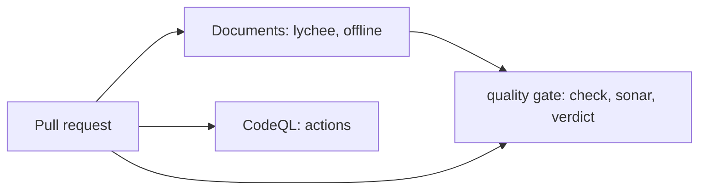

# Agents architecture

## 1. Context and Scope

Agents holds no code yet. The repository carries its documents and the CI that judges them; its purpose is in [the vision](VISION.md). The persona, memory and runner shape is not ruled yet, so no component is described here.

## 2. Building Block View

What exists today is the repository and the checks every pull request runs.

- **Documents** checks every relative link and anchor in the tracked Markdown.
- **The quality gate** is the shared workflow of overnightworks/quality. It runs its check and Sonar jobs and judges `Documents` through `quality/config.toml`; `quality / verdict` is the check a merge requires.
- **Code scanning** analyses the workflows under `.github`, the only code the repository has.
- **Dependabot** proposes updates to the pinned actions.
