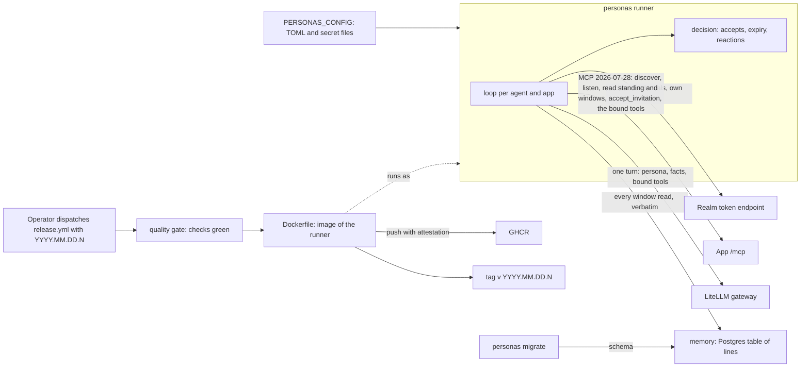

# Personas architecture

## 1. Context and Scope

Personas runs the operator's AI agents as people in his apps; its purpose is in [the vision](VISION.md). What exists is the runner: it signs each agent in to the realm as itself, keeps it listening in the apps it may join and lets it answer in a call. With a `[memory]` table it also keeps every line it reads in a Postgres of its own. What the agents do with that memory is not built yet, so no component for it is described here.

Personas owns the agents' credentials and the runner. The realm owns who an agent is and which apps it reaches, as group membership. An app owns participation and serves the member's standing as MCP resources, announces a change through `subscriptions/listen` and serves the accept tool on its `/mcp`; no app imports, calls or configures personas.

## 2. Building Block View

- **The runner** (`src/personas`, console script `personas`) reads and validates the configuration at start, then runs one loop for every agent and every app that listens.
- **A loop** takes a token by client credentials with the app's scope and renews it before it expires. It discovers the app's revision once per session, holds one `subscriptions/listen` for `member://standing`, and reads the standing through `resources/read` once the stream is acknowledged and again on every wake, so a change in a gap between streams is never lost. A wake only says that something changed; the loop acts on what it reads and accepts each invitation it has not seen refused as stale. It reopens at once after the app's graceful end of a stream, and holds its own deadline behind the app's bound so every re-listen renews the lease. A refusal by the realm or the app (a 4xx, a 401 after one renewal, a protocol error, a redirect, a read that is no standing, a stream that does not honor the standing or a revision the app does not share) suspends that loop, which retries at a bounded interval and resumes when a read answers; a network failure, a lost or overlong stream or a 5xx backs off with a capped interval, logged once until a read answers.
- **A turn** runs in an app that binds tools. After the loop's accepts it reads the window of each active call place (`member://standing/places/<kind>/<id>`); the lines after its checkpoint are new, and a new line that is not the agent's own and names the agent from its token's `agent_name` as a whole word in any case starts a turn. The checkpoint of each active call place lives on the loop, moves in the same synchronous step that creates the turn's task and survives every reaction and reopening, so a line starts at most one turn; where reading starts follows from how the agent came to the place: after its own accept the window is read from seq 1, while a place this process did not join (a restart) or one paused meanwhile takes the window's lines as read and answers only what is said after, and a window of another generation (a new join) is read from its seq 1; when the window has dropped lines past the checkpoint, the turn is told `missed`; a window the app lost drops its place's checkpoint and the standing is read once more in the same wake, so the place starts as restarted; when the agent has a turn-rate cap (the operator sets it; without one every addressed line starts a turn), it is reserved in that same step, against one counter of start times that all the agent's loops share for the process, so a line over the cap moves the checkpoint, starts no turn and is logged as `capped`, and a turn that ends short is not refunded; the standing is read in every wake, also while a turn runs, so the checkpoints follow it, while a window is read only between turns, except the window of an active place whose checkpoint is restarted or paused, which is read at once to set where reading starts and starts no turn, so a line said after a resume seen during a turn is answered once it ends. At most one turn runs per loop, and the end of a turn wakes the loop, so a line said meanwhile is answered next. A turn ends with its place: when a standing read shows the turn's place gone, invited again or paused, the loop cancels the turn's task and reports one `turn_ended` with the code `cancelled` once the task has ended, unless the turn had already reported its end; the slot stays taken until then, so no second turn starts while the first unwinds, and a cancelled turn's paid round still counts against the cap. An app that changes a window's generation while the place stays active does not cancel the turn. The turn opens its own session with its own bearer, lists the app's tools and gives the backend the persona as the system prompt, the room, the agent's name and every line (which are new, which are its own) as the only user message, and one hand tool per bound tool that relays to the app under the agent's token. The model gateway is agents' `GatewayBackend`, acting for the principal in the token (`iss`, `sub`) under the role `user`, and the token's `groups` must hold the gateway's `api_group`. A turn that ends short (the gateway refuses or fails, the group is missing, the key is unusable, a bound tool is no longer declared) logs its code and is silent otherwise; a stop that comes beside a late answer also backs the lifecycle off once. A `CallFailure` while the turn opens, discovers or lists tools goes into the loop's one reaction, since turn and lifecycle share the app, its URL and the token; so does a relayed call that fails, which ends the turn at once, with no further model round and no `turn_ended`; a defect met in the turn's session body or in a request to a tools-only app ends the runner loud however the turn ends: it is recorded, and what leaves the turn holds it once beside every other error, however a close or a cut replaced it, before any turn end is reported; and so does a loop or a turn that ends cancelled while nobody cancelled it (anyio's own scope cancellation after an SDK task failed), while every other error of a cancelled turn (a failed call, late answers) ends as its cancellation. A tool's error result is an answer: the model sees it and the turn goes on. The runner never retries a turn.
- **A tools-only app** (`listens = false`) has no loop: it starts no turn, and its bound tools reach the turns of the apps that listen, so a turn holds the tools of its place's app and of each tools-only app that answered, which adds nothing to the lifecycle. Each request to such an app (the listing at turn start, each relayed call) opens a session of its own under a token fetched for that app's own scope and ends it with the request, all under the app's `call_seconds`, so a cut connection or a lost SDK child ends only that session and no bearer reaches another app. A `CallFailure`, a session that died of its own child and an expiry of `call_seconds` never reach the loop's reaction: at turn start the app's tools are absent (also when it declares a bound tool no more), mid-turn the model sees an error result, and one `tools_only_app_failed` per app and turn is logged with the status code or a fixed word; a turn whose place left still stops, and any other error is a defect that ends the runner. The library's call bound is the sum of the bounds of the apps whose tools the turn holds, and each app also answers an error result past its own bound. No tool name is shared between a tools-only app and another app, since one turn holds both.
- **Decisions** (`decision.py`) are pure: standings in, accepts out; token expiry against a given clock; the reaction to a failure; which lines are new, missed and addressed; whether a turn may start under the cap; the facts a turn is told. When one session ends with several failures, one decides the reaction (a refusal before a renewal before a backoff); a defect among them ends the runner loud with every error kept.
- **Boundaries** are the token endpoint, the MCP session (the official SDK over the streamable HTTP of agents, where calls answer JSON and the listen is an SSE stream), the model gateway (`Boundaries.backend`, built only when an app binds tools), the clock, the log and the ready marker, each behind a narrow port so the loop is judged with scripted ones.
- **The memory** (`memory.py`, only with a `[memory]` table) is a Postgres table of the lines every loop read, written through `Boundaries.lines`. After the turn decision for a place, and before the loop goes on, the loop hands the whole window it read to the store; a line is keyed by agent, app, place, visit (the window's generation) and `seq`, with the time of the first read, the speaker's name, kind, text, `own` and `spoken`, so reading a window again changes nothing and the first read's time stands. U+0000 in any of that text is stored as U+FFFD, because Postgres refuses it. The adapter owns `write_seconds` as one bound around taking a connection, connecting and the statement against a store that answers (`inf` is no bound); a pooled connection that goes dark in the middle of a statement is given up only after the driver's own cancel wait, about ten seconds beyond it. A pooled connection is not checked before its use: a stale one fails its write, and the next takes another. A write that outlasts the bound, or meets a store that cannot be reached, raises `StoreUnavailable` with the code `store_timeout` or `store_unreachable`, which the loop catches at the write alone: it logs `store_failed` once with that code and `store_resumed` once the first write succeeds again, and never suspends or backs off the app or ends the runner. Places are read one after another, so a slow write delays the reading of the later places of that wake, and no turn already started. An error the store raises while its task is being cancelled ends as that cancellation. Any other database error raises `StoreDefect` with a code and no parameter, row or secret, and ends the runner. The runner opens no connection at start, so it starts while the store is down; the first write checks that the schema is at its head, and a schema behind it ends the runner, naming `memory`. `personas migrate` is the only code that changes the schema: synchronous, under an advisory lock, bounded by the driver's connect timeout alone; a store it cannot reach or a database error stops it with `personas: memory:` and the code. The whole window is written on every wake; writing only new lines would need a second checkpoint and waits for a measurement. Without `[memory]` no store is opened and no database library is loaded.
- **The image** (`Dockerfile`) installs the locked dependencies and the runner as a wheel into a slim Python image, runs as the non-root uid 1001 and starts `personas`, which as PID 1 handles SIGTERM itself and needs no init. It holds no configuration and no secret; the deployment supplies `PERSONAS_CONFIG` and the secret files.
- **The release path** (`.github/workflows/release.yml`) calls quality's reusable workflows: the gate judges the commit, the image is built and pushed to GHCR, and the tag follows. The README owns the release instructions.
- **The ready marker** (`readiness.py`) is the file named by `ready_file` in the configuration. The runner removes it before any loop starts and creates it the first time any loop's read of its standing answers; it is never removed afterwards, and a failure to remove or create it ends the runner with its path named. The platform's probe is `test -e <ready_file>`, so no interpreter starts per probe and the runner opens no port.
- **The log** holds each state change once (started, suspended, resumed, backoff, joined, refused, turn_ended, capped, tools_only_app_failed, store_failed, store_resumed) with the client id, the app and a status, refusal, turn or failure code, and no secret, token, gateway key, chat line or tool content.

## 3. Checks

Every pull request runs `Lint and test` (ruff, pyright strict, vulture, pytest with branch coverage, where `fail_under = 100` holds the number, against a Postgres service for the tests marked `postgres`; locally `scripts/test_postgres.sh` provides the same server, and a marked test fails without one), `Documents` (lychee, offline, over the tracked Markdown), `Image` (the build without a push, the refusal to start with no configuration, and the stop of a running container with exit code 0) and the shared quality gate of overnightworks/quality (its check and Sonar jobs), which judges them through `quality/config.toml`; `quality / verdict` is the check a merge requires. CodeQL analyses the workflows and the Python, and Dependabot proposes updates to the pinned actions, the locked dependencies and the Dockerfile's base images.
