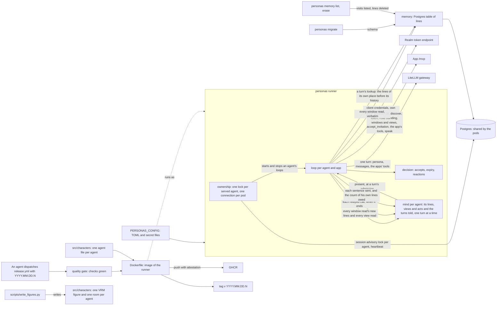

# Personas architecture

## 1. Context and Scope

Personas runs the operator's AI agents as people in his apps; its purpose is in [the vision](VISION.md). What exists is the runner: it signs each agent in to the realm as itself, keeps it listening in the apps it may join and lets it answer in a call, in writing or, in an app that speaks, aloud, and act at a place that serves a view when the view waits for it. Each agent has one history of the lines it took in, the view revisions it read and the calls relayed for it at all its places, in the order it took them, which every turn is told. Several runner pods may run side by side against one Postgres, and each agent is served by exactly one of them. With a `[memory]` table the runner also keeps every line it reads in that Postgres, where a turn can look up what was said earlier in its place.

Personas owns the agents' characters, their credentials and the runner. The realm owns who an agent is and which apps it reaches, as group membership. An app owns participation and serves the member's standing as MCP resources, announces a change through `subscriptions/listen` and serves the accept tool on its `/mcp`; no app imports, calls or configures personas.

## 2. Building Block View

- **The runner** (`src/personas`, console script `personas`) reads and validates the configuration at start, then runs one loop for every app that listens, for each agent while its pod owns the agent.
- **A loop** takes a token by client credentials with the app's scope and renews it before it expires. It discovers the app's revision once per session, holds one `subscriptions/listen` for `member://standing`, and reads the standing through `resources/read` once the stream is acknowledged and again on every wake, so a change in a gap between streams is never lost. A wake only says that something changed; the loop acts on what it reads and accepts each invitation it has not seen refused as stale, every accept carrying the figure and, as `voices`, the voice names in the order the agent's configuration entry names them, if it names any. It reopens at once after the app's graceful end of a stream, and holds its own deadline behind the app's bound so every re-listen renews the lease. A refusal by the realm or the app (a 4xx, a 401 after one renewal, a protocol error, a redirect, a read that is no standing, a stream that does not honor the standing or a revision the app does not share) suspends that loop, which retries at a bounded interval and resumes when a read answers; a network failure, a lost or overlong stream or a 5xx backs off with a capped interval, logged once until a read answers.
- **A turn** runs in an app that binds tools. After the loop's accepts it reads the window of each active place that is a call or serves a view (`member://standing/places/<kind>/<id>`); the lines after its checkpoint are new, and a new line that is neither the agent's own nor marked `act` makes a turn due at its place, except at a place that serves a view, where no line does (`decision.wakes_him`). The checkpoint of each active window place lives on the loop, moves in the same synchronous step that records the place's due turn and survives every reaction and reopening, so a line makes a turn due once; where reading starts follows from how the agent came to the place: after its own accept the window is read from seq 1, and that join lasts until the window is first read, also across standing reads that show the place active without a view, while a place this process did not join (a restart) or one paused meanwhile takes the window's lines as read and answers only what is said after, and a window of another generation (a new join) is read from its seq 1; when the window has dropped lines past the checkpoint, the turn is told `missed`; a window the app lost, which is also one a view place's app lists and answers as unknown, drops its place's checkpoint and the standing is read once more in the same wake, after the views were taken, so the place starts as restarted; the standing and every active window and view are read in every wake, also while a turn runs, so the checkpoints follow them; a reading checkpoint also keeps the `voice_state` its window last stated, and a place with no reading states nothing. One turn of the agent runs at a time across all his loops, held by his mind: a place's due is recorded in the synchronous step that moves the checkpoint or takes the view, and after each reconcile the loop claims the oldest due place when it is at its app, in one synchronous step with the start of the turn's task; lines due at one place join into one turn, told every line taken there since his last turn, and the end of any turn wakes every loop of the agent; a loop that backs off or suspends and a place that leaves drop their due, and a renew keeps it. A turn that calls no tool posts nothing. `turning.py` runs a turn, while `loop.py` starts the turn's task and holds the running turn for its cancel; its done callback writes the end line from the tally. A turn ends with its place: when a standing read shows the turn's place gone, invited again or paused, the loop cancels the turn's task and the turn's `turn.ended` is `cancelled` unless it had its final event, written once the task has ended; the slot stays taken until then, so no second turn starts while the first unwinds. An app that changes a window's generation while the place stays active does not cancel the turn. The turn opens its own session with its own bearer, lists the app's tools and binds every one it lists right now, but the runner's reserved names (`decision.RESERVED_TOOLS`'s) and the names an earlier app of the file holds (`decision.offered_declarations`; a turn that binds none runs without tools; the realm grants the app and the app decides what its tools let the agent do, so the runner keeps no list of tools) and gives the backend the persona as the system prompt and the user messages of `decision.turn_messages` (the header with his name, one message for each earlier answered turn the present still holds, rendered from the history and the told turns as they stand, and the turn's own message with its admission time, what woke it and every entry taken since the message before it), and one hand tool per bound tool that relays to the app under the agent's token. The relay's first step, before the app's bound and any await, compares the mind's history with the admitted one by `decision.arrived_since`; the first call of a turn that finds an entry not his own (a line of another speaker, an act line or a line at a view place included, or any view revision, his own lines, acts and spoken sentences never) is answered with `decision.held_told` instead of being sent: the model is told it was not sent and every entry that arrived, bounded by the library's event size, and decides again. The turn holds once; the library's total is the sum of the apps' bounds plus the held call. With a `[memory]` table the turn first holds the lookup `recall` (`recall.py` owns its declaration, read-only, and the room rule; `decision.RESERVED_TOOLS` holds the name back from every app), whose `lookup_calls` join that sum: the lookup reads the store through the loop's `Remembering` for the turn's own client id, app and place, every visit, and only lines first read before the first entry of the admitted history (`recall.line_search`), takes nothing into the history and is never held back, so after it every tool of the turn goes out as in a turn that did not look. It is bounded by `lookup_bytes` for one result and for its `text`, and by `write_seconds` for the read; a store that cannot answer gives an error result and `store.failed` through the loop's outage report, a defect or a schema behind its head leaves the handler as a failed relay and ends the runner as for a write. The text of a turn is spoken when it was admitted with `aloud` (see Speech) and dropped otherwise. The model gateway is agents' `GatewayBackend`, which the turn opens for its own run and closes when the turn ends, however it ends, and which acts for the principal in the token (`iss`, `sub`) under the role `user`, and the token's `groups` must hold the gateway's `api_group`. What an agent may spend is bounded at that gateway's budget; the runner sets no limit of its own. A turn that ends short (the gateway refuses or fails, the group is missing, the key is unusable) logs its code; a turn that ends with the library's final event writes `turn.ended` `ok` with the tokens of that event (see The log); a stop that comes beside a late answer also backs the lifecycle off once. A `CallFailure` while the turn opens, discovers or lists tools goes into the loop's one reaction, since turn and lifecycle share the app, its URL and the token; so does a relayed call that fails, which ends the turn at once, with no further model round, and its `turn.ended` is `failed` with the reason of the failure; a defect met in the turn's session body or in a request to another app ends the runner loud however the turn ends: it is recorded, and what leaves the turn holds it once beside every other error, however a close or a cut replaced it, before any turn end is reported; and so does a loop or a turn that ends cancelled while nobody cancelled it (anyio's own scope cancellation after an SDK task failed), while every other error of a cancelled turn (a failed call, late answers) ends as its cancellation. A tool's error result is an answer: the model sees it and the turn goes on. A tool result may carry one still picture, the same for the place's app, another app and a tools-only app and for a written and an aloud turn: `app_session.invoke` gives the model the result's one image block when its media type is the wire's `image/jpeg` and its data passes the library's `ToolImage`, and the library sends it in each later round of the turn. An image block is the wire's picture, so one of another media type, a second one or data that is not a JPEG breaks the wire and is an unusable answer (the place's app suspends its loop, another app fails as any app does), while audio and resource blocks are ignored. Every call a turn relays is recorded in the agent's mind, whether it was answered or its relay failed. A turn that ends without a final answer (the gateway refuses or fails, a limit is exceeded) makes its place due again, with what it was for, once its wait is over: the turn records the pause in the mind, which no turn of the agent starts before, and `Mind.due_again` (`decision.due_again`) puts the place back at once unless something newer made it due, where lines of the same generation join; a place he leaves meanwhile drops its due, and a cancelled turn is not retried. A defect, a failed relayed call and a late answer beside the stop end the runner or back the lifecycle off as before, and the lifecycle's backoff drops the app's due places.
- **Speech** (`voice.py`, run by the turn) speaks the text of a turn admitted with `aloud`, which the loop decides by `decision.speaks_aloud`: the turn is for lines, the agent's entry has a `[agents.voice]` table, the app declares `speak` and the place's last window does not state his voice `unavailable` (a turn admitted then is a written turn; a running turn keeps its admission); `config.py` refuses a persona file with a `voice` section. The loop reads that once per lifecycle session, so a `speak` declared later is picked up at the next reconnect. The request of such a turn carries the library's `REPLY_RULES` after the persona's prompt, the one owner of how a spoken reply reads, and a turn not admitted with `aloud` carries none; the character files state no rule on the channel or the reply. Such a turn builds one `Speaking` over its own session, place, the clock and the persona's `maxDurationSeconds`, hands it every backend event and plays its sentences in a task beside the events; the library's `ReplyReader` reads the reply round by round, releases whole sentences and mutes a round that opens with `[silent]` or an unreadable marker. Sentences go out in the order the model wrote them, one ahead of the one playing: the app answers a `speak` when its sentence's turn to play comes and plays in call order, so a sentence goes out as soon as the one before is answered `Spoken`, at most one request is open and the app renders the open sentence while the previous plays (the rule is fixed, as the wire defines no order for concurrent `speak` calls). Each `Spoken` answer owes one line of his own, whole or cut, and a refusal, a `Written` answer or a `stopped` yields none, so the k-th own spoken line pairs with the k-th `Spoken` without an id. The voice holds the count of answers and of lines, notes the history's `taken` as the mark when it first sends and moves it at every count (also at every take while a `speak` request is open), and waits on the mind's next-take event: `decision.own_spoken_lines_since` counts his own spoken lines at that app and place after the mark (whole or cut) and `decision.may_send_next` lets a sentence out while at most the one playing is still owed; it reads the history and the event in one synchronous step, so no take is lost between them. A tool call is relayed and the speech ends only once nothing is owed, also after a refusal silenced the rest, because the turn awaits the speech before it asks the backend for the event that relays the call. The token is renewed before each `speak`. The one bound of all those waits and of the open `speak` is what `decision.remaining_seconds` leaves of the turn's deadline, one clock sleep for the speech raced against the event or the request; a bound that is done first, a tie included, raises `TurnStopped` with `limit_exceeded`, so a line that never enters ends the turn loud and the rest of its speech goes, and a request given up then enters once as unanswered with that code (`decision.speech_outcome`). A request or line given up may still play, so its line enters in a later turn and can shift that turn's count by one. Each `speak` the turn sends enters the history as a `SaidAloud`, a `speech` entry, however its request ends; it is the agent's own, so it holds no call, and it is no act, because the turn never holds `speak`. A refusal is logged by its code and ends the turn's speech while the turn goes on; the runner never turns it into a line. A `Written` answer (the app posted the sentence at the place as his written line) enters as a `speech` entry told as written and leaves the speech going. A `speak` that fails or answers neither `Spoken`, `Written` nor a refusal is raised as `RelayFailed`, as a relayed call to the own app is, and goes into the loop's one reaction; a defect ends the runner loud through the turn's record. The deadline is `decision.past_deadline` (derived from `remaining_seconds`) over the clock, asked before each sentence and when the speech before a call has passed; past it the speech raises the library's `TurnStopped` with `limit_exceeded`, which the turn reports once, and the gateway's own refusal is the backstop of the same bound. When the events end in an error, the queued sentences are dropped and the open `speak` is answered and entered without its wait for a line; a cancel cuts the speech, its waits and the open request with the turn, entering that request as unanswered and re-raising, and a turn that ends normally ends once his line for its last sentence has entered. A `stopped` answer, as the app's own `stop_speaking` gives it, cuts the sentence playing, whose cut line is still awaited, and drops every sentence not yet sent. When a turn's session leaves with a stop beside the one that ends the turn, a plain stop adds nothing and a relay stop adds the failure it holds. No line, sentence or model text reaches a log.
- **A view place** is a standing with `serves_view`, whatever its kind: the app's own view of it holds the place's newest state and its window what happened there, in lines, and both are read; the window has a checkpoint by the call's rules, so a place that stops serving a view and serves one again starts as restarted, unless he accepted it and its window was never read, which keeps its join. An invitation to a place of another kind than a call is accepted by the call's accept and refusal memory whether or not its standing serves a view yet, since an app marks an invited standing as serving none until it is active, and so is an invitation to a call that serves a view, only where the loop has its turn setup; `decision.left_out_for` names the invitations left out for want of it, and the loop reports each once with `invitation.left_out`. The loop keeps beside the checkpoints, per active view place, the revision a turn was last started for; it survives every reaction, and a place that left the standing loses it. In every wake, also while a turn runs, the loop reads the standing, then the view (`member://standing/places/<kind>/<id>/view`) of each active view place in the standing's order, then every window, and only then takes the views: a window read after its view is complete up to that revision, and the lines enter the history before the view. A view is stamped with the time of its read, not of its take, so its time is true although the window writes lie between; the lines the window holds past the view's revision are told before the view, and a talk line at a view place gets no turn of its own, because only `awaits_you` calls him. A turn at a view place is never told `missed`, and an act of his own at a table is told twice, as his relayed call and as his own act line. `view_turn_due` then decides on each view: a turn is due while the view waits for the agent at a revision no turn was started for, which makes a turn due at that place in the mind in the same synchronous step that takes the view; a revision that does not wait, and a view the app gives none, take the place's due away. Every view the loop reads goes to the mind, after the lines of that wake, before `view_turn_due` decides, and the admission of the turn carries the revision, which is how `turning.py` builds its text (`turn_told`, the one message every turn is told, whose `woke` holds the app's `mcp_url`, kind and id and the `revision` the turn is for); everything else about the turn is a written turn's. The end of any turn, however it ended, wakes every loop of the agent; a revision that waits gets one turn and no second unless that turn ended without an answer (see A turn), and the runner never asks again by itself otherwise: an app that wants him to act again moves the revision, and a tool's error result reaches the model inside the same turn. The loop reads a view only after a standing read and never polls a tool. A view the app shows the member no more reads as none: no turn and no failure, and the next standing read shows why. An app that lists a view and its window but serves the window as unknown, or lists an empty window, costs no extra turn and no failure: the first costs one more standing read per wake and the second nothing; a window read that fails backs the app off before any view of that wake is taken. Only apps the operator configured to listen can invite the agent, the app's own rights gate who may, and what people put into a view reaches the agent as their lines do.
- **A tools-only app** (`listens = false`) has no loop: it starts no turn, and its tools reach the turns of the apps that listen, so a turn holds the tools of its place's app, of the apps it holds (see A held app) and of each tools-only app that answered, which adds nothing to the lifecycle. Each request to such an app (the listing at turn start, each relayed call) opens a session of its own under a token fetched for that app's own scope and ends it with the request, all under the app's `call_seconds`, so a cut connection or a lost SDK child ends only that session and no bearer reaches another app. A `CallFailure`, a session that died of its own child and an expiry of `call_seconds` never reach the loop's reaction: at turn start the app's tools are absent when its listing fails (a tool the app does not list is simply not there), mid-turn the model sees an error result and the app takes no more calls in that turn, its bound spent, and one `tools_only_app.failed` per app and turn is written with the status and a closed reason; the call is recorded in the mind as an act either way; a turn whose place left still stops, and any other error is a defect that ends the runner. The turn's call bound (the sum of the apps' bounds plus the held call) is stated in the turn bullet, and each app also answers an error result past its own bound. A name two apps offer is declared once, for the first app in the configuration's order; the later app's copy is left out, and the loop writes one `tools.left_out` per app session with the number of names and no name.
- **A held app** is a listening app that binds tools, where the agent holds an active place when a turn at another of his apps is admitted: `decision.lends_tools` decides it from each standing read and `decision.held_apps` names the apps a turn holds, fixed in the claim's synchronous step. The turn declares the tools of all its apps, its own included, in the configuration's order and within an app in the app's listing order, so a call turn and a table turn that hold the same apps declare the same list. A held app is listed and called as a tools-only app is: a session per request under a token for its own scope, within its `call_seconds`, past the hold, counting its own calls against its own bound, which joins the turn's total. A call to a held or tools-only app that comes back as a `CallFailure` answers an error result and spends that app's bound, so every later call to it in the turn answers the call bound's text and sends nothing, and one `held_app.failed` or `tools_only_app.failed` is written with its status and reason; a refusal by the app is an answer and spends nothing beyond the call; a failed call to the turn's own app still ends the turn into its loop's reaction. A listing that fails leaves the app's tools out and is reported once; a name an earlier app holds is left out as above. The turn's `aloud` stays that of its place, so a table turn can write in his call and speaks nowhere, and `speak` is never a turn's tool. No bearer reaches another app: each request has a token of its own scope.
- **Decisions** (`decision.py`, over `recall.py` for the period after which a kept line is swept and for what the store gives a turn (the lookup's declaration, its room, its argument check and its result) and `entries.py` for the entries of the history and how they are told, imported one way only) are pure: standings in, accepts out; token expiry against a given clock; the reaction to a failure; which lines are new and missed, which make a turn due, and which due place's turn starts; whether a call place's turn is spoken (its stated voice included), how many of his own spoken lines have entered since a mark and whether his next sentence may go, what is left of a turn's deadline and whether it is past it; which places serve a view, whether a view's revision is due a turn; which entries the agent's history keeps (every view revision read once, lines, states, acts and spoken sentences, and, past `history_bytes`, the one step that leaves what fits `history_keep_bytes`, the newest entry always); the messages every turn is sent (`turn_messages`): the header, one message for each answered turn the present holds and the turn's own, each with the entries taken since the message before it, each line marked `own` and `spoken` and, when the app cut it, `cut` and, when it says what someone did, `act`, each entry with its absolute time, and what woke the turn (the `seqs` of its lines or the `revision` of its view) and whether its answer is heard aloud; which entries arrived since a turn's admission and what a held call is told of them. When one session ends with several failures, one decides the reaction (a refusal before a renewal before a backoff); how long his turns wait after a turn the gateway refused for a spent budget (`budget_pause`: doubling from the backoff base up to `budget_pause_cap_seconds`); a defect among them ends the runner loud with every error kept.
- **The mind** (`mind.py`) holds one agent's present in memory, which is his history and the answered turns whose messages it still holds: a `Mind` per agent, built by the runner and handed to each of the agent's loops. In the synchronous step that moves a window place's checkpoint, before the wake rule, the loop hands the lines that read took, as `KeptLine`s with the time of the read and the app's `mcp_url`, to the mind; what is taken (restart, pause, a lost window, a generation, each line once) is the checkpoint's, so the mind checks none of it again. Each relay that passed its app's bound, to the place's app or another app, records one `ActDone` into the mind in a `finally` when its request ends, with the clock's wall time, whatever its outcome (the app's answer, or no answer with the failure's code, or `cancelled` while the turn's task is being cancelled; `decision.act_outcome` decides it, and a defect records nothing); a held call records nothing. Each `speak` the turn sends records one `SaidAloud` the same way, with the app's `Spoken` or refusal, or the failure's code, or `cancelled` (`decision.speech_outcome`). The view step runs after that wake's lines and hands the mind each view it read, as a `ViewSeen` with the time of the read, before `view_turn_due` decides; a revision of an app and place that the history holds adds nothing, whatever its state. The history holds the lines and the views in the order of the reads, across apps, counted in the bytes of each line, act and sentence as told and the JSON bytes of each state. Between steps entries only join at the newest end, so every message of the request stays as it was sent. A turn that ends with an answer joins the present (`Mind.answered`), and its message is rendered from the history and from where the message before it ended; a turn that ends without one joins nothing. Past `history_bytes` (configuration, default 49152) `decision.taken_into` makes one step: the oldest whole messages leave, with the entries they told, until what stays fits `history_keep_bytes` (default 32768, never above `history_bytes`), and the header is rendered again with `older_dropped`; when the newest message alone is past `history_keep_bytes` its oldest entries leave too, and its newest entry always stays. Entries leave only from the oldest end, and the history counts what left and the entries not his own it took, which is how a turn finds what arrived since its admission. An act answered with a picture is told with `image: true` and holds no picture byte, so the picture is gone when its turn ends; no view or act is stored. It also holds the apps where he holds an active place, recorded with each standing read of that app's loop, when the app binds tools, and cleared when that loop backs off or suspends, which a turn at another app reads at its admission to know the apps it holds. It also holds the agent's `Turns` (`decision.py`: whether a turn of his runs, which places have one due, in the order they became due, with what each turn is for, and until when no turn of his may start) and one wake event per loop, which the end of a turn, the end of a pause and a due place dropped while no turn runs set. It also counts his turns in a row that ended without an answer; each records in the `Turns`, in the step that ends it, the pause `decision.budget_pause` gives after a spent budget and `decision.backoff_delay` after any other stop, and the loop's claim refuses a turn while the pause lasts, so what arrives meanwhile enters the history and makes one turn after it with the place of the turn that ended, and a turn that ends with an answer resets the count. The pause is the mind's, so it outlives its turn's task and its place: a place that leaves, or a cancel, shortens nothing, and the turn of another place waits for the same end. A loop whose oldest due place waits for a pause sleeps its rest on the clock and then wakes every loop of the agent. Each take that adds an entry sets the event `next_take` gave before it, which is how a turn's voice learns that his own line has entered. It needs no store, is lost on a restart and is read at every turn's admission, which fixes the turn's history. An app is named by its `mcp_url`, so a changed URL splits the history as it splits the memory.
- **Boundaries** are the token endpoint, the MCP session (the official SDK over the streamable HTTP of agents, where calls answer JSON and the listen is an SSE stream), the model gateway (`Boundaries.backend`, built only when an app binds tools), the clock, the log and the ready marker, each behind a narrow port so the loop is judged with scripted ones.
- **Ownership** (`ownership.py` over `locks.py`) lets several pods serve one set of agents without two of them serving the same agent. `run_all` hands each agent's serving, its loops over a history of its own, to `LockedOwnership`, which runs one round after another, each starting `contend_seconds` after the start of the one before. A round is one bounded call on the pod's lock connection (`PostgresAgentLocks`, one psycopg session opened when it has none): it reads which of this session's advisory locks it holds, takes each free agent's with `pg_try_advisory_lock`, and answers the agents held. The locks use the two-integer form, a namespace of their own and a digest of the client id as the second integer, so they never meet `migrate`'s one-integer lock. An agent newly held is reported as `agent.taken` and started only after `grace_seconds`; an agent no longer held, or every agent when the round fails, is cancelled and awaited (its loops, and the turns under them) before the next round, which is what keeps a tool call or `speak` of the old holder from leaving after the new holder's grace. A round that raises, or runs past `heartbeat_timeout_seconds`, drops the connection, since the server frees a session's locks only when the session ends; the next round opens a new one. The holder does not wait for an overrunning round to unwind, because the driver may take seconds to cancel a query on a connection that does not answer: it reports the connection lost at the bound and the round closes its own connection in the background, while a round that would start before it ended reports the connection lost too, so the pod never holds a second connection, and closing the connection waits for it. `config.py` refuses a grace at or below `contend_seconds + heartbeat_timeout_seconds + cancel_margin_seconds`: the holder notices within the first two of a round's start and needs the margin to stop. SIGTERM cancels the ownership, which stops every agent, and the composition then closes the connection, which frees the locks. A defect of an agent's serving ends the runner. Readiness (`readiness.py`) is announced by `run_all` once a round has answered: the pod is contending. The connection budget of a pod is the lock connection plus the store's pool of 5 and overflow of 10 with a `[memory]` table: 16, or 1 without; the README adds the surge and the commands. What does not move between pods is the process's own state: history, checkpoints, a pause and the running turn restart with a new holder, so a line already answered gets no second turn. An event-loop stall longer than the grace is the one case two pods could speak at once, which only a fencing token on the wire would close; and a silent loss of the connection frees the locks only after the server's TCP keepalive, a cost in liveness alone.
- **The memory** (`memory.py`, only with a `[memory]` table) is a Postgres table of the lines every loop read, written through `Boundaries.lines`. After the lines of a place are taken, and before the loop goes on, the loop hands the whole window it read to the store; a line is keyed by agent, app, place, visit (the window's generation) and `seq`, with the time of the first read, the speaker's name, kind, text, `own`, `spoken`, `cut` (migration 0002) and `act` (migration 0003; earlier rows are false), so reading a window again changes nothing and the first read's time stands. U+0000 in any of that text is stored as U+FFFD, because Postgres refuses it. The `LineStore` port also reads for a turn's lookup (`search`): the lines of one agent's app and place by the primary key's first four columns, whatever the visit, that hold every word of the text under Postgres full text with the `simple` configuration (a text without a word matches every line) and were first read before the time `recall.py` gives, newest first and at most the rows `recall.py` computes from `lookup_bytes`; there is no index and no migration, and a U+0000 in the text or the place's key is replaced as in a write. It runs under the same bound, schema check and error mapping as a write. The adapter owns `write_seconds` as one bound around taking a connection, connecting and the statement against a store that answers (`inf` is no bound); a pooled connection that goes dark in the middle of a statement is given up only after the driver's own cancel wait, about ten seconds beyond it. The write runs inside the stream deadline of the listen, so a large or absent bound costs more than memory: a store that goes dark then holds the loop's reconcile until that deadline and the driver's cancel wait, the stream ends as lost, the app is backed off as `network`, the turn already running is cancelled with its answer, and no `store.failed` is written. A pooled connection is not checked before its use: a stale one fails its write or read, and the next takes another. A write that outlasts the bound, or meets a store that cannot be reached, raises `StoreUnavailable` with the code `store_timeout` or `store_unreachable`, which the loop catches at the write and at a turn's lookup, both through its `Remembering`: it writes `store.failed` once with that code and `store.resumed` once the store answers a write or read again, and never suspends or backs off the app or ends the runner. Places are read one after another, and the turn a wake made due starts only after that wake's windows were written, so a slow write delays the reading of the later places of that wake and the turn that wake made due, by up to `write_seconds` for each window read, and no turn already started. A write cancelled from outside ends as that cancellation, also when its connection breaks while the driver waits for its own cancel: an outage the store raises while its task has a cancellation pending is that cancellation. Any other database error raises `StoreDefect` with a code and no parameter, row or secret, and ends the runner, also when its task is being cancelled meanwhile. The runner starts while the store is down, since the locks need no schema; the store's first use checks that the schema is at its head, and a schema behind it ends the runner, naming `memory`. That first use is the first sweep at start, unless `lines_keep_days` is `inf`, and else the first write or read. `personas migrate` is the only code that changes the schema: synchronous, under an advisory lock, bounded by the driver's connect timeout alone, which under `inf` is the driver's own default; a store it cannot reach or a database error stops it with `personas: memory:` and the code. A database at a revision none of the release's scripts names was migrated by a newer release, which changes the schema only by adding to it while two releases run: the schema check serves it and `migrate` leaves it, whereas a known revision behind the head still ends the runner. A kept line is deleted by whoever runs `personas memory erase` with the runner's configuration, and so holds the database's password: for one agent's client id, as given, or for all of them, in one statement; `personas memory list` shows per visit its agent, place, count and times, no content. Both go through the store's own engine, schema check, error mapping and `write_seconds` bound, outside the runner, and after a `store_timeout` a run with a larger bound erases what is left: no loop lists or erases, and the runner's `LineStore` port has neither. The whole window is written on every wake; writing only new lines would need a second checkpoint and waits for a measurement. The sweep (`sweep.py`) is one task beside the `run_all` task, which runs the ownership and, under it, the loops in their own groups; `run_with_sweep` in `main.py` starts both in one group, so a defect in either ends the runner and a SIGTERM ends it with the loops, also inside a sweep or its wait. With `[memory]` it deletes, once at the start and then after every `sweep_minutes` on the clock boundary, every line of every agent whose first read lies before the time `decision.py` gives from the clock and `lines_keep_days` (`inf` keeps every line and sends no statement; `inf` minutes sweep once): one statement through the store's own bound, schema check and error mapping, whose count a `lines.swept` line holds without any content. A `StoreUnavailable` is written as `store.failed` once per outage and `store.resumed` when a sweep succeeds again, and the next interval tries again; any other database error is a defect. The sweep takes the store through its own port, `erase_before`, which the composition hands it beside the loops' `LineStore` as the same object, so that port stays as it is; a very large first sweep can outlast `write_seconds` and is then tried again whole, and several pods on one database each sweep, which is harmless as the deletion is idempotent. Without `[memory]` no store is opened, the store's library is not loaded and a turn holds no lookup.
- **The image** (`Dockerfile`) installs the locked dependencies and the runner as a wheel into a slim Python image, runs as the non-root uid 1001 and starts `personas`, which as PID 1 handles SIGTERM itself and needs no init. It holds no configuration and no secret; the deployment supplies `PERSONAS_CONFIG` and the secret files. It holds the agents' files of `src/characters/` at `/app/characters/`, readable and not writable by the runner; a deployment names one per agent as `persona_file`.
- **The figure generator** (`scripts/write_figures.py` and `scripts/figures/`, standard library only) writes one VRM 1.0 file per persona into `src/characters/` from surfaces lofted through cross-sections on a T-posed skeleton, deterministically, with a licence meta that carries the repository's MIT `LICENSE`. The wardrobes in `persona_wardrobes.py` tell the personas apart. It also writes each persona's room, `<name>.room.glb`: one static mesh in one unlit material whose light, sun and sky through its windows, is baked into the vertex colours (`room_shapes.py`, `room_light.py`, `room_glb.py`; Mozart's salon in `mozart_room.py` and `mozart_furniture.py`, Leonardo's workshop in `leonardo_room.py` and `leonardo_furniture.py`, the rooms in `persona_rooms.py`). The files are tracked output, never edited by hand, and the image leaves them out because the runner never reads them.
- **The release path** (`.github/workflows/release.yml`) calls quality's reusable workflows: the gate judges the commit, the image is built and pushed to GHCR, and the tag follows. The README owns the release instructions.
- **The ready marker** (`readiness.py`) is the file named by `ready_file` in the configuration. The runner removes it before the ownership starts and creates it once a round of the ownership answered, so a pod that holds no agent is ready; it is never removed afterwards, and a failure to remove or create it ends the runner with its path named. The platform's probe is `test -e <ready_file>`, so no interpreter starts per probe and the runner opens no port.
- **The log** is logline's JSON on stdout (`configure_logging` in `main.py`), and `reporting.py` writes each state change once as a literal `<noun>.<verb_past>` event (`loop.started`, `loop.suspended`, `loop.backed_off`, `loop.resumed`, `invitation.accepted`, `invitation.refused`, `invitation.left_out`, `turn.ended`, `turn_wait.ended`, `token_hold.ended`, `token_request.ended`, `session_open.ended`, `tool_list.ended`, `turn_setup.ended`, `turns.paused`, `speak.refused`, `tools_only_app.failed`, `held_app.failed`, `store.failed`, `store.resumed`, `lines.swept`, `agent.taken`, `agent.lost`) with the ids `agent_id` and `app_id` (the host of the app's URL) and a closed `reason` (a code of a refusal, turn or failure). A `tools_only_app.failed`, `held_app.failed`, `loop.suspended` or `loop.backed_off` of a call that failed holds the integer `status` of an error status, the failed MCP `mcp_method` and a `reason` that `failure_reason` in `decision.py` maps from what the answer carried: a standard JSON-RPC error or a known media type by name, else one fixed word, never the app's own value or content; a JSON-RPC error the app sent in an answer with a success status holds no `status` and no `mcp_method`. A `loop.started` holds the `model` the agent's turns run on when the agent has a persona; a `turns.paused` holds the code of the turn that ended without an answer, `budget_spent` among them, as `reason` and the wait as `pause_ms`; an `invitation.left_out` holds the reason `no_turns` and the place's `place_kind`. A `tools.left_out` holds the app that lost names to an earlier app and their `tool_count`, never a name. A `turn.ended` is written once per turn by the loop's done callback of the turn's task, on logline's `StepTimer` started when the turn is claimed (`start_turn_tally` in `reporting.py`), whatever way the task ends; `turn_ending` in `decision.py` maps the ending to the `outcome` (`ok`, `refused` by the gateway, `failed` at level error, `cancelled`) and the closed `reason` of the first two (a stop's code, the reason of the failure that decides the loop's reaction, `defect`, `no_final_event`); a turn that got its final event is `ok` whatever its teardown then met. It holds `duration_ms`, `sentence_count` (counted in `voice.py` where a sentence is sent to `speak`, refused and cut ones included), `first_output_ms` (the first such send), `silent_count` and `tool_call_count`, and, of a turn that sent a model request, the byte counts `tools_bytes` (the declarations each request carries), `told_bytes` (every message sent), `results_bytes` (the results relayed back to the model, held calls included) and `images_bytes` (the decoded bytes of their pictures, 0 without one), measured in `turning.py`; one that got a final event holds, when the library's usage is present, `input_tokens`, `cached_input_tokens`, `cache_write_tokens`, `output_tokens` and `model_request_count` as the library gives them for the turn, and none of the five otherwise, never zero. No decision of the runner reads them. `_start_turn` opens `logline.unit_trace` around the creation of the turn's task and its done callback, so the task, its tasks and the callback share one `trace_id` and the loop's own lines carry none; the same trace holds the turn's step lines, each a `StepTimer` of `reporting.step_timer` with `agent_id`, `app_id`, `duration_ms` and `outcome`, and a failed step's closed `reason` from `error_reason` in `decision.py`: `turn_wait.ended` (written by `_start_turn` from `Due.since`, the earliest `time.perf_counter` moment of a line still waiting that the turn answers, which `decision.with_due` keeps through a join or a replacement and `due_again` sets to the end of the pause a turn without an answer left, so that pause is no wait of the turn due again, while a line that arrives during the pause keeps its arrival through the join), then, in `turning.py`, `token_hold.ended`, `session_open.ended` and `tool_list.ended` (the turn's own app and each other app it lists) and `turn_setup.ended`, from the task's first step to the first step of the model backend's run, containing the others. `token_request.ended` is written by `HttpTokenSource.fetch` for each call to the realm, in a turn or not. One httpx request hook, `carry_trace` in `reporting.py`, sets `traceparent` from `logline.current_traceparent()` on every request of the MCP client to an app (`open_mcp_session`) and of the token client to the realm (`real_boundaries`), and sets none outside a trace; the `_BearerAuth` adds only the bearer. agents puts the same current traceparent on every request to the model gateway and writes a `model_request.ended` per model request and a `tool_call.ended` per tool call, so all stay in the turn's trace; its lines are listed in its `docs/connector.md`, "The log". A failure of the turn's own app is still logged where its exception stops, in the loop's context. The sweep's `lines.swept` names no agent or app and carries the `line_count` removed; the ownership's `agent.taken` and `agent.lost` name the agent and no app, and the lock connection's outage is `store.failed` and `store.resumed` as the sweep's is, and no line holds a secret, token, gateway key, chat line or tool content. logline's `configure` caps the `mcp` and Postgres dialect loggers at warning, because their INFO records carry content. Only the runner configures logging: `personas migrate` and `personas memory` print their own result on stdout, which no JSON line shares.

## 3. Checks

Every pull request runs `Lint and test` (ruff, pyright strict, vulture, pytest with branch coverage, where `fail_under = 100` holds the number, against a Postgres service for the tests marked `postgres`; locally `scripts/test_postgres.sh` provides the same server, and a marked test fails without one), `Documents` (lychee, offline, over the tracked Markdown), `Image` (the build without a push, the refusal to start with no configuration, a start with every agent file the image holds, and the stop of a running container with exit code 0), `Figures` (`scripts/check_figures.sh`: the generator's output equals the tracked `src/characters/*.vrm` and `*.room.glb`, none more and none fewer, and `figure check` from figure's pinned release, whose sha512 is verified before it runs, passes each figure and, `--as room`, each room) and the shared quality gate of overnightworks/quality (its check and Sonar jobs), which judges them through `quality/config.toml`; `quality / verdict` is the check a merge requires. CodeQL analyses the workflows and the Python, and Dependabot proposes updates to the pinned actions, the locked dependencies and the Dockerfile's base images.
