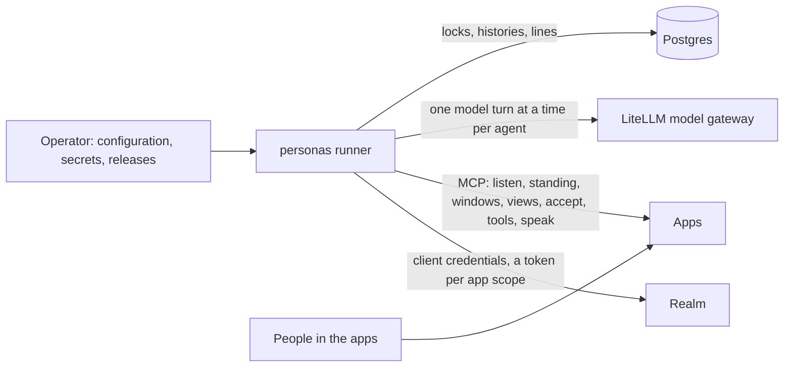
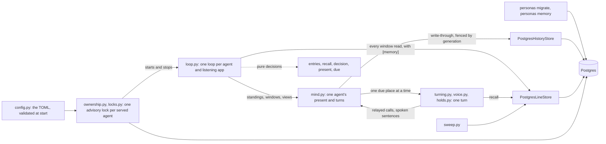

# Personas architecture

For an engineer changing the runner: its parts, who talks to whom, where the boundaries and the trust lie.
What personas is for is in [the vision](VISION.md); what each part promises in detail is in the
references [turns](turns.md), [configuration](configuration.md) and [log](log.md).

## 1. Context and Scope

The runner signs each of the operator's agents in to the realm as itself, keeps it listening in the apps it
may reach, and lets it take part there: answer in a call in writing or aloud, act at a table, use the tools
the apps grant it. Personas owns the agents' characters, their credentials and the runner. The realm owns
who an agent is and which apps it reaches. An app owns participation and its tools; no app imports, calls or
configures personas.



## 2. Building Block View



- **Composition** (`main.py`) reads the configuration, builds the real boundaries and runs the ownership
  and the sweep side by side; it also serves the commands `migrate` and `memory`.
- **Ownership** (`ownership.py` over `locks.py`) lets several pods serve one set of agents, each agent by
  one pod at a time: a round every `contend_seconds` takes free locks and confirms held ones.
- **A loop** (`loop.py`, `app_session.py`, `tokens.py`; `runner.py` starts one for each agent and listening app) holds one token and one `subscriptions/listen` per
  agent and app on agents' member client (`agents.mcp_client`, opened in `app_session.py`), reads the standing on every wake, accepts invitations, then reads windows and views;
  `turn_states.py` states what his turns at each place do on its session, and on one of its own while the
  loop waits to retry or he stops.
- **The mind** (`mind.py`) holds one agent's present in memory: his history, the answered turns it tells,
  his due places in the order they are claimed, his pause, one turn at a time across all his apps, and per place a speech record, in
  memory only: the request in flight, the sentences released and not yet sent, each with its turn's time bound, the
  sentence that plays, the hold that stands there with what was said over him and whether a turn was told it, and
  the id of the hold decided last. A turn's `Speaking` (`voice.py`) releases its sentences into it; the record
  outlives the turn.
- **A turn** (`turning.py`) runs on its loop's session at its own app, lists the tools of its apps (the place's own app's list is kept on the loop's session while a stream that carries the tools notice is open, and a notice, an acknowledgement or a stream's end drops it; a turn a notice overtook before it ended does not count for its view's revision), sends the
  gateway the persona and the told messages, and relays each call; it ends when the backend's events end, not
  when its sentences have played. `voice.py` reads an aloud turn's reply into sentences, `turn_bound.py` bounds the
  turn's waits and the sentences it released, `holds.py` decides a hold (the round beside the parked run, the
  decision of a turn told it and the end of the hold in the app), `held_tools.py` and `turn_sessions.py` reach the
  other apps a turn holds. His text while a hold is undecided answers it: `voice.py` sends the first
  sentence to `speak` naming the hold, on a session of its own, and puts the rest into the record.
- **A sender** (`voice.py`) is a task of the loop's serving group at each place where a turn spoke, on the loop's
  session: it sends the record's unsent sentences to `speak`, one request at a time, also after the turn, and
  nothing while a hold stands. The loop cancels and awaits it before the session closes.
- **Decisions** (`entries` <- `recall` <- `speech` <- `decision` <- `present` <- `due`) are pure: no process, network or
  clock. `config.py` alone owns the TOML's fields and refusals.
- **The stores** (`memory.py`, its migrations in `src/personas/migrations`) are the history store, always,
  and the line store with `[memory]`; `sweep.py` removes old lines.
- **Boundaries** are the token endpoint, agents' member client (the MCP session), the model gateway, the clock, the log, the ready
  marker (`readiness.py`) and the stores, each behind a narrow port so the loop is driven with scripted ones.
- **Characters** (`src/characters/<name>.md`) are the agents' persona files, shipped in the image. Their
  figures and rooms (`*.vrm`, `*.room.glb`) are written by `scripts/write_figures.py` and never by hand; the
  image does not hold them, and the runner does not read them.

## 3. Runtime View

The core flow: a person says a line in a call and the agent answers.

```mermaid
sequenceDiagram
    participant App
    participant Loop
    participant Mind
    participant Store as History store
    participant Turn
    participant Gateway
    App-->>Loop: listen wakes: something changed
    Loop->>App: read the standing, then the window
    Loop->>Mind: take the new lines; the place is due
    Mind->>Store: write through under his generation
    Loop->>Mind: claim the oldest due place
    Loop->>Turn: start the turn
    par the claim is written
        Mind-->>Turn: the claim is kept in the store
        Turn->>App: state thinking
    and the tools are listed
        opt the session keeps no list of the app's tools
            Turn->>App: list the tools of his apps
        end
    end
    Turn->>Gateway: persona and told messages
    Gateway-->>Turn: a tool call, say
    Turn->>Mind: did anything arrive that holds the call?
    Turn->>App: relay say
    App-->>Turn: answer
    Turn->>Mind: the call and its answer enter the history
    Turn-->>Loop: turn.ended
```

A takeover: a pod that newly holds an agent's lock waits `grace_seconds`, renews his generation, loads his
history and kept turns, and starts his loops. The pod it took him from has stopped by then, because the
grace outlasts the time a losing pod needs to stop him; the bound is in
[the configuration reference](configuration.md), `[ownership]`.

## 4. Deployment View

The image (`Dockerfile`) holds the runner and the persona files, runs as the non-root uid 1001 and starts
`personas`, which handles SIGTERM as PID 1 and exits 0 on that clean stop; a stop that outlasts its deadline
ends at once, as [the configuration reference](configuration.md), `[ownership]`, says. It holds no
configuration and no secret. The deployment in overnightworks/platform supplies `PERSONAS_CONFIG`, the
secret files and the Postgres database, runs `personas migrate`, probes readiness with
`test -e <ready_file>`, and may run several pods against one database. The runner opens no port. The
release path is in [the release runbook](runbooks/release.md).

## 5. Crosscutting Concepts

**Persistence.** Every pod uses one Postgres, named by the required `[database]` table:

| Table | Holds | Kept until |
|---|---|---|
| `history_entries` | lines, table states, calls, spoken sentences, skills he read | the cut past `history_bytes`, or `memory erase` |
| `answered_turns` | what each answered turn's message told | the entries it told left, or `memory erase` |
| `agent_turns` | checkpoints, due places, unanswered count, pause end | next write; on a takeover, as below |
| `agent_owner` | the generation of the pod that owns him | every takeover and every erase renews it |
| `lines`, with `[memory]` | every line of every window he read | a sweep past `lines_keep_days`, or `memory erase` |

The mind writes through on every change, under his generation, so a write from a pod that lost him is
refused. A restart or a takeover loads his history and turns, and his next turn is told what the holder
before would have told, byte for byte. A takeover keeps his turns of the generation just before the new one
and drops older ones, so a takeover after one by a release that keeps no turns starts him without any; an
erase keeps them. What a pod took in after its last write is lost when it dies;
which turn a stop hands to the new holder is in [the turns reference](turns.md), Pauses and retries. A place
read before resumes where reading stood, so a line said while no pod served him gets one turn; how a place
reads is in [the turns reference](turns.md), Joining and reading. A history entry keeps a call's arguments
and answer; how the cut shrinks the history to `history_keep_bytes` is in
[the turns reference](turns.md), What a turn is told. A kept line holds its text verbatim, its speaker and
its first-read time, from which the sweep counts `lines_keep_days`. A line a sweep removed from a window the
app still holds is kept again with a new first-read time. Without `[memory]` no sweep runs, so lines kept
before stay until `memory erase`. No picture byte is kept anywhere. `personas memory list` and
`personas memory erase` show and erase what an agent keeps; see [the runbook](runbooks/erase-memory.md).
`personas migrate` is the only code that changes the schema, and a release only adds to it while two
releases run.

**Trust.** The model as the code and `AGENTS.md` state it today. The operator and his configuration are
trusted. Secrets enter only as files the configuration names, are held in `secret.Secret`, and reach no
log line, error or repr. Each agent signs in as itself with its own client. The realm decides which apps it
reaches; each app decides what its tools let it do. The runner keeps no list of allowed tools, and each
request to an app carries a token of that app's scope only. People in the apps are untrusted. Their lines,
table states and tool answers reach the model as user messages, none of them an instruction; nothing but
the apps' tools and the gateway's budget bounds what the model then does. A turn holds the tools of every
app where the agent sits, so what is said in one app can lead to a call in another, and so can a lookup's
result. Postgres holds content verbatim: names, lines, table states, tool arguments and answers. Whoever
holds the database password reads it. The runner sets no TLS mode, so the driver's defaults apply;
encryption at rest and network access to the database are the platform's and unknown here. The model
gateway sees the persona and everything a turn is told. The log carries ids, numbers and closed codes, never
content, a token or a secret. Unknown here: how the realm and each app enforce their grants, which their
own repositories own.

**Proof strategy.** Pure decisions are unit tests with many cases. The loop, turns, voice and ownership run
against scripted boundaries and in-process fakes of the realm, the gateway and an app (`tests/support`).
Tests marked `postgres` drive the stores and several pods against a throwaway Postgres. Branch coverage is
100 % over all of them (`fail_under` in `pyproject.toml`). CI adds the image build with its start and stop,
the figures' regeneration check,
the offline link check, and quality's shared gate (`quality / verdict`), which holds the import direction to
the layers contract under `[tool.importlinter]` in `pyproject.toml`. The contract `core-imports-no-adapter`
there holds the core's own imports free of adapters, and the gate's adapter-import rule applies it to core
unit tests and the support modules they import.

**Errors.** A failure that could corrupt the history, the store or ownership ends the runner loud. A refusal
by the realm or an app suspends that loop, a network failure backs it off, and a store outage is logged
once and retried.

## 6. Constraints and reasons

- One turn at a time per agent, across all his apps: his history is one ordered story, and every request is
  the earlier one plus what is new, so the gateway's cache reads it back.
- A history only grows between steps and leaves in one step from its oldest end, for the same cache.
- A pod serves an agent only while it holds his lock and after the grace, so two pods never speak for him
  at once, short of an event-loop stall longer than the grace.
- Decisions stay pure and are imported one way only, so every rule is tested without a process.
- No app depends on personas: an absent runner only makes the agents absent.

## 7. Not chosen

- A fencing token on the wire: it would close the stall case above; it reopens once a double speech is seen.
- Writing only a window's new lines to the line store: it needs a second checkpoint; it reopens with a
  measurement that the whole-window write costs too much.
- An index for the lookup: it reopens when a room's lookup outlasts `write_seconds`.

## 8. Risks and Technical Debt

- An event-loop stall longer than `grace_seconds` can let two pods speak for one agent.
- A connection that goes silent frees its locks only after the server's TCP keepalive: liveness, not safety.
- Every line heard costs a model call, except a spoken line the app marked as followed by more of the same
  speaker's speech; two agents in one call can keep each other talking, bounded only by the gateway's budget.
- People are told apart by display name only.
- Files over the size limit, functions over the complexity limit and near-identical pairs stand as debt in
  `quality/baseline.toml`, which quality holds from growing.
