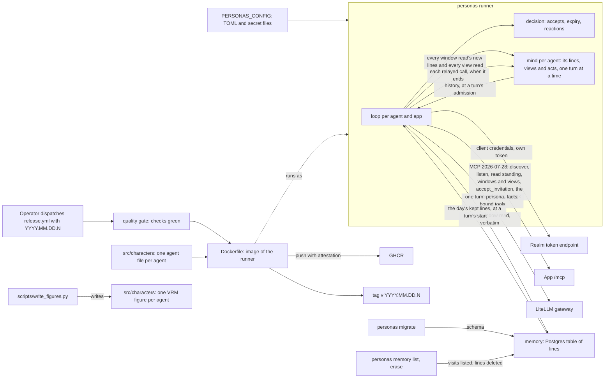

# Personas architecture

## 1. Context and Scope

Personas runs the operator's AI agents as people in his apps; its purpose is in [the vision](VISION.md). What exists is the runner: it signs each agent in to the realm as itself, keeps it listening in the apps it may join and lets it answer in a call, in writing or, in an app that speaks, aloud, and act at a place that serves a view when the view waits for it. Each agent has one history of the lines it took in, the view revisions it read and the calls relayed for it at all its places, in the order it took them, which every turn is told. With a `[memory]` table it also keeps every line it reads in a Postgres of its own, and a turn is told what of the day its history no longer holds.

Personas owns the agents' characters, their credentials and the runner. The realm owns who an agent is and which apps it reaches, as group membership. An app owns participation and serves the member's standing as MCP resources, announces a change through `subscriptions/listen` and serves the accept tool on its `/mcp`; no app imports, calls or configures personas.

## 2. Building Block View

- **The runner** (`src/personas`, console script `personas`) reads and validates the configuration at start, then runs one loop for every agent and every app that listens.
- **A loop** takes a token by client credentials with the app's scope and renews it before it expires. It discovers the app's revision once per session, holds one `subscriptions/listen` for `member://standing`, and reads the standing through `resources/read` once the stream is acknowledged and again on every wake, so a change in a gap between streams is never lost. A wake only says that something changed; the loop acts on what it reads and accepts each invitation it has not seen refused as stale, every accept carrying the figure and the voice name the agent's configuration entry names, if it names them. It reopens at once after the app's graceful end of a stream, and holds its own deadline behind the app's bound so every re-listen renews the lease. A refusal by the realm or the app (a 4xx, a 401 after one renewal, a protocol error, a redirect, a read that is no standing, a stream that does not honor the standing or a revision the app does not share) suspends that loop, which retries at a bounded interval and resumes when a read answers; a network failure, a lost or overlong stream or a 5xx backs off with a capped interval, logged once until a read answers.
- **A turn** runs in an app that binds tools. After the loop's accepts it reads the window of each active place that is a call or serves a view (`member://standing/places/<kind>/<id>`); the lines after its checkpoint are new, and a new line that is neither the agent's own nor marked `act` makes a turn due at its place, except at a place that serves a view, where no line does (`decision.wakes_him`). The checkpoint of each active window place lives on the loop, moves in the same synchronous step that records the place's due turn and survives every reaction and reopening, so a line makes a turn due once; where reading starts follows from how the agent came to the place: after its own accept the window is read from seq 1, and that join lasts until the window is first read, also across standing reads that show the place active without a view, while a place this process did not join (a restart) or one paused meanwhile takes the window's lines as read and answers only what is said after, and a window of another generation (a new join) is read from its seq 1; when the window has dropped lines past the checkpoint, the turn is told `missed`; a window the app lost, which is also one a view place's app lists and answers as unknown, drops its place's checkpoint and the standing is read once more in the same wake, after the views were taken, so the place starts as restarted; the standing and every active window and view are read in every wake, also while a turn runs, so the checkpoints follow them; a reading checkpoint also keeps the `voice_state` its window last stated, and a place with no reading states nothing. One turn of the agent runs at a time across all his loops, held by his mind: a place's due is recorded in the synchronous step that moves the checkpoint or takes the view, and after each reconcile the loop claims the oldest due place when it is at its app, in one synchronous step with the start of the turn's task; lines due at one place join into one turn, told every line taken there since his last turn, and the end of any turn wakes every loop of the agent; a loop that backs off or suspends and a place that leaves drop their due, and a renew keeps it. A turn that calls no tool posts nothing. `turning.py` runs a turn, while `loop.py` starts the turn's task and holds the running turn for its cancel and its end report. A turn ends with its place: when a standing read shows the turn's place gone, invited again or paused, the loop cancels the turn's task and reports one `turn_ended` with the code `cancelled` once the task has ended, unless the turn had already reported its end; the slot stays taken until then, so no second turn starts while the first unwinds. An app that changes a window's generation while the place stays active does not cancel the turn. The turn opens its own session with its own bearer, lists the app's tools, binds the configured tools the app lists right now in binding order (`decision.bound_declarations`; one it does not list is left out, one it lists that is not configured never enters, and a turn that binds none runs without tools) and gives the backend the persona as the system prompt and the one message of `decision.py` (the agent's name, the day, the history as the admission fixed it with the lines the turn is for marked new, and what woke the turn) as the only user message, and one hand tool per bound tool that relays to the app under the agent's token. The relay's first step, before the app's bound and any await, compares the mind's history with the admitted one by `decision.arrived_since`; the first call of a turn that finds an entry not his own (a line of another speaker, an act line or a line at a view place included, or any view revision, his own lines, acts and spoken sentences never) is answered with `decision.held_told` instead of being sent: the model is told it was not sent and every entry that arrived, bounded by the library's event size, and decides again. The turn holds once; the library's total is the sum of the apps' bounds plus the held call. The text of a turn is spoken when it was admitted with `aloud` (see Speech) and dropped otherwise. The model gateway is agents' `GatewayBackend`, acting for the principal in the token (`iss`, `sub`) under the role `user`, and the token's `groups` must hold the gateway's `api_group`. What an agent may spend is bounded at that gateway's budget; the runner sets no limit of its own. A turn that ends short (the gateway refuses or fails, the group is missing, the key is unusable) logs its code; a turn that ends with the library's final event logs `turn_ended` with no code and the tokens of that event (see The log); a stop that comes beside a late answer also backs the lifecycle off once. A `CallFailure` while the turn opens, discovers or lists tools goes into the loop's one reaction, since turn and lifecycle share the app, its URL and the token; so does a relayed call that fails, which ends the turn at once, with no further model round and no `turn_ended`; a defect met in the turn's session body or in a request to another app ends the runner loud however the turn ends: it is recorded, and what leaves the turn holds it once beside every other error, however a close or a cut replaced it, before any turn end is reported; and so does a loop or a turn that ends cancelled while nobody cancelled it (anyio's own scope cancellation after an SDK task failed), while every other error of a cancelled turn (a failed call, late answers) ends as its cancellation. A tool's error result is an answer: the model sees it and the turn goes on. A tool result may carry one still picture, the same for the place's app, another app and a tools-only app and for a written and an aloud turn: `app_session.invoke` gives the model the result's one image block when its media type is the wire's `image/jpeg` and its data passes the library's `ToolImage`, and the library sends it in each later round of the turn. An image block is the wire's picture, so one of another media type, a second one or data that is not a JPEG breaks the wire and is an unusable answer (the place's app suspends its loop, another app fails as any app does), while audio and resource blocks are ignored. Every call a turn relays is recorded in the agent's mind, whether it was answered or its relay failed. A turn that ends without a final answer (the gateway refuses or fails, a limit is exceeded) makes its place due again, with what it was for, once its wait is over: the turn holds his slot for the wait, then `Mind.due_again` (`decision.due_again`) puts the place back unless something newer made it due meanwhile, where lines of the same generation join; a place he left meanwhile is not made due again, and a cancelled turn is not retried. A defect, a failed relayed call and a late answer beside the stop end the runner or back the lifecycle off as before, and the lifecycle's backoff drops the app's due places.
- **Speech** (`voice.py`, run by the turn) speaks the text of a turn admitted with `aloud`, which the loop decides by `decision.speaks_aloud`: the turn is for lines, the agent's entry has a `[agents.voice]` table, the app declares `speak` and the place's last window does not state his voice `unavailable` (a turn admitted then is a written turn; a running turn keeps its admission); `config.py` refuses a persona file with a `voice` section. The loop reads that once per lifecycle session, so a `speak` declared later is picked up at the next reconnect. Such a turn builds one `Speaking` over its own session, place, the clock and the persona's `maxDurationSeconds`, hands it every backend event and plays its sentences in a task beside the events; the library's `ReplyReader` reads the reply round by round, releases whole sentences and mutes a round that opens with `[silent]` or an unreadable marker. One request is in flight at a time on the turn's session, in the order the model wrote them: a sentence goes out after the one before has been answered and its wait, the smaller of the answered length and the bound `decision.py` owns, has passed through the clock, and a tool call is relayed only after every sentence released before it, because the turn awaits the speech before it asks the backend for the event that relays the call. The token is renewed before each `speak`. Each `speak` the turn sends enters the history as a `SaidAloud`, a `speech` entry, however its request ends; it is the agent's own, so it holds no call, and it is no act, because the turn never holds `speak`. A refusal is logged by its code and ends the turn's speech while the turn goes on; the runner never turns it into a line. A `Written` answer (the app posted the sentence at the place as his written line) enters as a `speech` entry told as written, adds no wait and leaves the speech going. A `speak` that fails or answers neither `Spoken`, `Written` nor a refusal is raised as `RelayFailed`, as a relayed call to the own app is, and goes into the loop's one reaction; a defect ends the runner loud through the turn's record. The deadline is `decision.past_deadline` over the clock, asked before each sentence and when the speech before a call has passed; past it the speech raises the library's `TurnStopped` with `limit_exceeded`, which the turn reports once, and the gateway's own refusal is the backstop of the same bound. When the events end in an error, the queued sentences are dropped and the `speak` in flight is answered and entered without its wait; a cancel cuts the speech with the turn, and the turn ends once its last sentence's wait has passed. No line, sentence or model text reaches a log.
- **A view place** is a standing with `serves_view`, whatever its kind: the app's own view of it holds the place's newest state and its window what happened there, in lines, and both are read; the window has a checkpoint by the call's rules, so a place that stops serving a view and serves one again starts as restarted, unless he accepted it and its window was never read, which keeps its join. An invitation to a place of another kind than a call is accepted by the call's accept and refusal memory whether or not its standing serves a view yet, since an app marks an invited standing as serving none until it is active, and so is an invitation to a call that serves a view, only where the loop has its turn setup; `decision.left_out_for` names the invitations left out for want of it, and the loop reports each once with `invitation_left_out`. The loop keeps beside the checkpoints, per active view place, the revision a turn was last started for; it survives every reaction, and a place that left the standing loses it. In every wake, also while a turn runs, the loop reads the standing, then the view (`member://standing/places/<kind>/<id>/view`) of each active view place in the standing's order, then every window, and only then takes the views: a window read after its view is complete up to that revision, and the lines enter the history before the view. A view is stamped with the time of its read, not of its take, so its age is true although the window writes lie between; the lines the window holds past the view's revision are told before the view, and a talk line at a view place gets no turn of its own, because only `awaits_you` calls him. A turn at a view place is never told `missed`, and an act of his own at a table is told twice, as his relayed call and as his own act line. `view_turn_due` then decides on each view: a turn is due while the view waits for the agent at a revision no turn was started for, which makes a turn due at that place in the mind in the same synchronous step that takes the view; a revision that does not wait, and a view the app gives none, take the place's due away. Every view the loop reads goes to the mind, after the lines of that wake, before `view_turn_due` decides, and the admission of the turn carries the revision, which is how `turning.py` builds its text (`turn_told`, the one message every turn is told, which marks that revision's entry of the history new while `woke` holds the app's `mcp_url`, kind and id); everything else about the turn is a written turn's, the day included. The end of any turn, however it ended, wakes every loop of the agent; a revision that waits gets one turn and no second unless that turn ended without an answer (see A turn), and the runner never asks again by itself otherwise: an app that wants him to act again moves the revision, and a tool's error result reaches the model inside the same turn. The loop reads a view only after a standing read and never polls a tool. A view the app shows the member no more reads as none: no turn and no failure, and the next standing read shows why. An app that lists a view and its window but serves the window as unknown, or lists an empty window, costs no extra turn and no failure: the first costs one more standing read per wake and the second nothing; a window read that fails backs the app off before any view of that wake is taken. Only apps the operator configured to listen can invite the agent, the app's own rights gate who may, and what people put into a view reaches the agent as their lines do.
- **A tools-only app** (`listens = false`) has no loop: it starts no turn, and its bound tools reach the turns of the apps that listen, so a turn holds the tools of its place's app, of the apps it holds (see A held app) and of each tools-only app that answered, which adds nothing to the lifecycle. Each request to such an app (the listing at turn start, each relayed call) opens a session of its own under a token fetched for that app's own scope and ends it with the request, all under the app's `call_seconds`, so a cut connection or a lost SDK child ends only that session and no bearer reaches another app. A `CallFailure`, a session that died of its own child and an expiry of `call_seconds` never reach the loop's reaction: at turn start the app's tools are absent when its listing fails (a bound tool the app does not list is left out without a report), mid-turn the model sees an error result and the app takes no more calls in that turn, its bound spent, and one `tools_only_app_failed` per app and turn is logged with the status code or a fixed word; the call is recorded in the mind as an act either way; a turn whose place left still stops, and any other error is a defect that ends the runner. The turn's call bound (the sum of the apps' bounds plus the held call) is stated in the turn bullet, and each app also answers an error result past its own bound. No tool name is bound by two apps, since one turn holds the tools of several.
- **A held app** is a listening app that binds tools, where the agent holds an active place when a turn at another of his apps is admitted: `decision.lends_tools` decides it from each standing read and `decision.held_apps` names the apps a turn holds, fixed in the claim's synchronous step. The turn declares the tools of all its apps, its own included, in the configuration's order and within an app in the binding's, so a call turn and a table turn that hold the same apps declare the same list. A held app is listed and called as a tools-only app is: a session per request under a token for its own scope, within its `call_seconds`, past the hold, counting its own calls against its own bound, which joins the turn's total. A call to a held or tools-only app that comes back as a `CallFailure` answers an error result and spends that app's bound, so every later call to it in the turn answers the call bound's text and sends nothing, and one `held_app_failed` or `tools_only_app_failed` is logged with its code; a refusal by the app is an answer and spends nothing beyond the call; a failed call to the turn's own app still ends the turn into its loop's reaction. A listing that fails leaves the app's tools out and is reported once; a bound tool the app does not list is left out without a report. The turn's `aloud` stays that of its place, so a table turn can write in his call and speaks nowhere, and `speak` is never a turn's tool. No bearer reaches another app: each request has a token of its own scope.
- **Decisions** (`decision.py`, over `recall.py` for the day a turn is told and `entries.py` for the entries of the history and how they are told, imported one way only) are pure: standings in, accepts out; token expiry against a given clock; the reaction to a failure; which lines are new and missed, which make a turn due, and which due place's turn starts; whether a call place's turn is spoken (its stated voice included), how long its voice waits after a sentence and whether a turn is past its deadline; which places serve a view, whether a view's revision is due a turn; which entries the agent's history keeps (every view revision read once, lines, states, acts and spoken sentences within `history_bytes`, newest first, the newest always); how far back a turn reaches into the day and which kept lines it is told, leaving out by key every line the history holds (views are no part of the day) and every line first read after the admission; the one message every turn is told, with its history, each line marked `own` and `spoken` and, when the app cut it, `cut` and, when it says what someone did, `act`, and what woke it, and whether its answer is heard aloud; which entries arrived since a turn's admission and what a held call is told of them. When one session ends with several failures, one decides the reaction (a refusal before a renewal before a backoff); how long his turns wait after a turn the gateway refused for a spent budget (`budget_pause`: doubling from the backoff base up to `budget_pause_cap_seconds`); a defect among them ends the runner loud with every error kept.
- **The mind** (`mind.py`) holds one agent's history in memory: a `Mind` per agent, built by the runner and handed to each of the agent's loops. In the synchronous step that moves a window place's checkpoint, before the wake rule, the loop hands the lines that read took, as `KeptLine`s with the time of the read and the app's `mcp_url`, to the mind; what is taken (restart, pause, a lost window, a generation, each line once) is the checkpoint's, so the mind checks none of it again. Each relay that passed its app's bound, to the place's app or another app, records one `ActDone` into the mind in a `finally` when its request ends, with the clock's wall time, whatever its outcome (the app's answer, or no answer with the failure's code, or `cancelled` while the turn's task is being cancelled; `decision.act_outcome` decides it, and a defect records nothing); a held call records nothing. Each `speak` the turn sends records one `SaidAloud` the same way, with the app's `Spoken` or refusal, or the failure's code, or `cancelled` (`decision.speech_outcome`). The view step runs after that wake's lines and hands the mind each view it read, as a `ViewSeen` with the time of the read, before `view_turn_due` decides; a revision of an app and place that the history holds adds nothing, whatever its state. The history holds the lines and the views in the order of the reads, across apps, within `history_bytes` (configuration, default 32768) of each line and act as told, its age counted as 0, and of the JSON bytes of each state, with the same newest-first count as the day's bound; the newest entry stays even when it alone is past the bound. Entries leave only from the oldest end, and the history counts what left and the entries not his own it took, which is how a turn finds what arrived since its admission. An act answered with a picture is told with `image: true` and holds no picture byte, so the picture is gone when its turn ends; no view or act is stored. It also holds the apps where he holds an active place, recorded with each standing read of that app's loop, when the app binds tools, and cleared when that loop backs off or suspends, which a turn at another app reads at its admission to know the apps it holds. It also holds the agent's `Turns` (`decision.py`: whether a turn of his runs and which places have one due, in the order they became due, with what each turn is for) and one wake event per loop, which the end of a turn and a due place dropped while no turn runs set. It also counts his turns in a row that ended without an answer; `turning.py` holds the turn's slot for the wait `decision.budget_pause` gives after a spent budget and `decision.backoff_delay` after any other stop, so what arrives meanwhile enters the history and makes one turn after it with the place of the turn that ended, and a turn that ends with an answer resets the count. It needs no store, is lost on a restart and is read at every turn's admission, which fixes the turn's history. An app is named by its `mcp_url`, so a changed URL splits the history as it splits the memory.
- **Boundaries** are the token endpoint, the MCP session (the official SDK over the streamable HTTP of agents, where calls answer JSON and the listen is an SSE stream), the model gateway (`Boundaries.backend`, built only when an app binds tools), the clock, the log and the ready marker, each behind a narrow port so the loop is judged with scripted ones.
- **The memory** (`memory.py`, only with a `[memory]` table) is a Postgres table of the lines every loop read, written through `Boundaries.lines`. After the lines of a place are taken, and before the loop goes on, the loop hands the whole window it read to the store; a line is keyed by agent, app, place, visit (the window's generation) and `seq`, with the time of the first read, the speaker's name, kind, text, `own`, `spoken`, `cut` (migration 0002) and `act` (migration 0003; earlier rows are false), which a turn is told with every line it is told, so reading a window again changes nothing and the first read's time stands. U+0000 in any of that text is stored as U+FFFD, because Postgres refuses it. The adapter owns `write_seconds` as one bound around taking a connection, connecting and the statement against a store that answers (`inf` is no bound); a pooled connection that goes dark in the middle of a statement is given up only after the driver's own cancel wait, about ten seconds beyond it. The write runs inside the stream deadline of the listen, so a large or absent bound costs more than memory: a store that goes dark then holds the loop's reconcile until that deadline and the driver's cancel wait, the stream ends as lost, the app is backed off as `network`, the turn already running is cancelled with its answer, and no `store_failed` is logged. A pooled connection is not checked before its use: a stale one fails its write or read, and the next takes another. A write that outlasts the bound, or meets a store that cannot be reached, raises `StoreUnavailable` with the code `store_timeout` or `store_unreachable`, which the loop catches at the write and the read alone: it logs `store_failed` once with that code and `store_resumed` once the store answers a write or read again, and never suspends or backs off the app or ends the runner. Places are read one after another, and the turn a wake made due starts only after that wake's windows were written, so a slow write delays the reading of the later places of that wake and the turn that wake made due, by up to `write_seconds` for each window read, and no turn already started. A write cancelled from outside ends as that cancellation, also when its connection breaks while the driver waits for its own cancel: an error the store raises while its task has a cancellation pending is that cancellation. Any other database error raises `StoreDefect` with a code and no parameter, row or secret, and ends the runner. The runner starts while the store is down; the store's first use checks that the schema is at its head, and a schema behind it ends the runner, naming `memory`. That first use is the first sweep at start, unless `lines_keep_days` is `inf`, and else the first write or read. `personas migrate` is the only code that changes the schema: synchronous, under an advisory lock, bounded by the driver's connect timeout alone, which under `inf` is the driver's own default; a store it cannot reach or a database error stops it with `personas: memory:` and the code. A kept line is deleted by whoever runs `personas memory erase` with the runner's configuration, and so holds the database's password: for one agent's client id, as given, or for all of them, in one statement; `personas memory list` shows per visit its agent, place, count and times, no content. Both go through the store's own engine, schema check, error mapping and `write_seconds` bound, outside the runner, and after a `store_timeout` a run with a larger bound erases what is left: no loop lists or erases, and the runner's `LineStore` port has neither. The whole window is written on every wake; writing only new lines would need a second checkpoint and waits for a measurement. A turn reads the day inside its own task, before it opens its session, so the read never stands between the move of a checkpoint and the turn's creation: the lines its agent's client id kept whose first read lies within `today_hours`, at the wall time the turn was admitted, which is after the writes of the wake that made it due, and under the same `write_seconds` bound, error mapping and once-per-outage `store_failed` as a write; a view turn reads it too. `decision.py` leaves out of them every line whose visit and `seq` the turn's history holds and every line first read after the admission, groups the rest by visit, orders the visits by their first line and the lines by `seq`, and past `today_bytes` of the lines as told keeps the newest, the lines left out counting nothing toward it; the turn is told them before its history as `earlier_today`, each visit with the minutes since its first line, the lines with speaker, kind, text, `own`, `spoken` and, when true, `cut` and `act`, and whether older lines were left out. A read the store cannot answer now lets the turn run without the day; any other database error is a defect. The sweep (`sweep.py`) is one task beside the `run_all` task, which runs the loops in its own group; `run_with_sweep` in `main.py` starts both in one group, so a defect in either ends the runner and a SIGTERM ends it with the loops, also inside a sweep or its wait. With `[memory]` it deletes, once at the start and then after every `sweep_minutes` on the clock boundary, every line of every agent whose first read lies before the time `decision.py` gives from the clock and `lines_keep_days` (`inf` keeps every line and sends no statement; `inf` minutes sweep once): one statement through the store's own bound, schema check and error mapping, whose count a `swept` line logs without any content. A `StoreUnavailable` is logged as `store_failed` once per outage and `store_resumed` when a sweep succeeds again, and the next interval tries again; any other database error is a defect. The sweep takes the store through its own port, `erase_before`, which the composition hands it beside the loops' `LineStore` as the same object, so that port stays as it is; a very large first sweep can outlast `write_seconds` and is then tried again whole, and several runners on one database would each sweep. Without `[memory]` no store is opened, no database library is loaded and a turn is told no day.
- **The image** (`Dockerfile`) installs the locked dependencies and the runner as a wheel into a slim Python image, runs as the non-root uid 1001 and starts `personas`, which as PID 1 handles SIGTERM itself and needs no init. It holds no configuration and no secret; the deployment supplies `PERSONAS_CONFIG` and the secret files. It holds the agents' files of `src/characters/` at `/app/characters/`, readable and not writable by the runner; a deployment names one per agent as `persona_file`.
- **The figure generator** (`scripts/write_figures.py` and `scripts/figures/`, standard library only) writes one VRM 1.0 file per persona into `src/characters/` from surfaces lofted through cross-sections on a T-posed skeleton, deterministically, with a licence meta that carries the repository's MIT `LICENSE`. The wardrobes in `persona_wardrobes.py` tell the personas apart. The files are tracked output, never edited by hand, and the image leaves them out because the runner never reads them.
- **The release path** (`.github/workflows/release.yml`) calls quality's reusable workflows: the gate judges the commit, the image is built and pushed to GHCR, and the tag follows. The README owns the release instructions.
- **The ready marker** (`readiness.py`) is the file named by `ready_file` in the configuration. The runner removes it before any loop starts and creates it the first time any loop's read of its standing answers; it is never removed afterwards, and a failure to remove or create it ends the runner with its path named. The platform's probe is `test -e <ready_file>`, so no interpreter starts per probe and the runner opens no port.
- **The log** holds each state change once (started, suspended, resumed, backoff, joined, refused, invitation_left_out, turn_ended, paused, speak_refused, tools_only_app_failed, held_app_failed, store_failed, store_resumed, swept) with the client id, the app and a status, refusal, turn or failure code (a `paused` holds the code of the turn that ended without an answer, `budget_spent` among them, and the wait in `seconds`; an `invitation_left_out` holds the reason `no_turns` and the place's kind, never its content); a `turn_ended` of a turn that sent a model request holds the byte counts `tools_bytes` (the declarations each request carries), `told_bytes`, `results_bytes` (the results relayed back to the model, held calls included) and `images_bytes` (the decoded bytes of their pictures, 0 without one), measured in `turning.py`, none before a request and none on a cancelled turn, and one that follows a final event holds no code and, when the library's usage is present, the counts `input`, `cache_read`, `cache_write` and `output` as the library gives them for the turn, and none of the four otherwise, never zero, and no decision of the runner reads them; the sweep's lines name no agent or app and `swept` carries the number of lines removed, and no secret, token, gateway key, chat line or tool content.

## 3. Checks

Every pull request runs `Lint and test` (ruff, pyright strict, vulture, pytest with branch coverage, where `fail_under = 100` holds the number, against a Postgres service for the tests marked `postgres`; locally `scripts/test_postgres.sh` provides the same server, and a marked test fails without one), `Documents` (lychee, offline, over the tracked Markdown), `Image` (the build without a push, the refusal to start with no configuration, a start with every agent file the image holds, and the stop of a running container with exit code 0), `Figures` (`scripts/check_figures.sh`: the generator's output equals the tracked `src/characters/*.vrm`, none more and none fewer, and `figure check` from figure's pinned release, whose sha512 is verified before it runs, passes each) and the shared quality gate of overnightworks/quality (its check and Sonar jobs), which judges them through `quality/config.toml`; `quality / verdict` is the check a merge requires. CodeQL analyses the workflows and the Python, and Dependabot proposes updates to the pinned actions, the locked dependencies and the Dockerfile's base images.
