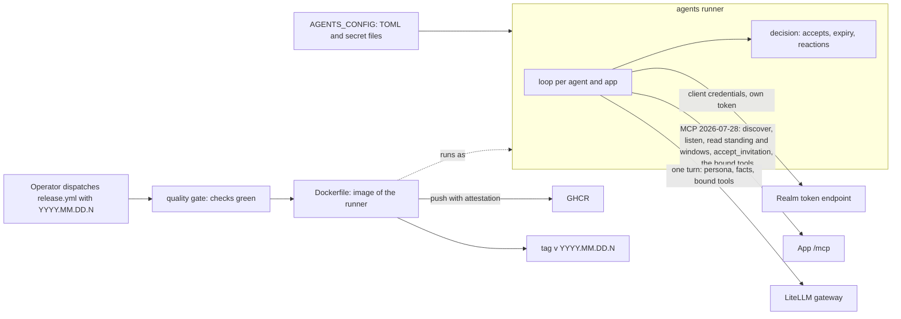

# Agents architecture

## 1. Context and Scope

Agents runs the operator's AI agents as people in his apps; its purpose is in [the vision](VISION.md). What exists is the runner: it signs each agent in to the realm as itself, keeps it listening in the apps it may join and lets it answer in a call. The persona and memory shape is not ruled yet, so no component for them is described here.

Agents owns the agents' credentials and the runner. The realm owns who an agent is and which apps it reaches, as group membership. An app owns participation and serves the member's standing as MCP resources, announces a change through `subscriptions/listen` and serves the accept tool on its `/mcp`; no app imports, calls or configures agents.

## 2. Building Block View

- **The runner** (`src/agents`, console script `agents`) reads and validates the configuration at start, then runs one loop for every agent and every app.
- **A loop** takes a token by client credentials with the app's scope and renews it before it expires. It discovers the app's revision once per session, holds one `subscriptions/listen` for `member://standing`, and reads the standing through `resources/read` once the stream is acknowledged and again on every wake, so a change in a gap between streams is never lost. A wake only says that something changed; the loop acts on what it reads and accepts each invitation it has not seen refused as stale. It reopens at once after the app's graceful end of a stream, and holds its own deadline behind the app's bound so every re-listen renews the lease. A refusal by the realm or the app (a 4xx, a 401 after one renewal, a protocol error, a redirect, a read that is no standing, a stream that does not honor the standing or a revision the app does not share) suspends that loop, which retries at a bounded interval and resumes when a read answers; a network failure, a lost or overlong stream or a 5xx backs off with a capped interval, logged once until a read answers.
- **A turn** runs in an app that binds tools. After the loop's accepts it reads the window of each active call place (`member://standing/places/<kind>/<id>`); the lines after its read position are new, and a new line that is not the agent's own and names the agent from its token's `agent_name` as a whole word in any case starts a turn. The read position of each place lives on the loop, moves in the same synchronous step that creates the turn's task and survives every reaction and reopening, so a line starts at most one turn; after the agent's own accept it starts over at seq 1. At most one turn runs per loop, and the end of a turn wakes the loop, so a line said meanwhile is answered next. The turn opens its own session with its own bearer, lists the app's tools and gives the backend the persona as the system prompt, the room, the agent's name and every line (which are new, which are its own) as the only user message, and one hand tool per bound tool that relays to the app under the agent's token. The model gateway is agent-runtime's `GatewayBackend`, acting for the principal in the token (`iss`, `sub`) under the role `user`, and the token's `groups` must hold the gateway's `api_group`. A turn that ends short (the gateway refuses or fails, the group is missing, the key is unusable, a bound tool is no longer declared) logs its code and is silent otherwise. A `CallFailure` while the turn opens, discovers or lists tools goes into the loop's one reaction, since turn and lifecycle share the app, its URL and the token; a defect ends the runner loud. The runner never retries a turn.
- **Decisions** (`decision.py`) are pure: standings in, accepts out; token expiry against a given clock; the reaction to a failure; which lines are new and addressed; the facts a turn is told. When one session ends with several failures, one decides the reaction (a refusal before a renewal before a backoff); a defect among them ends the runner loud with every error kept.
- **Boundaries** are the token endpoint, the MCP session (the official SDK over the streamable HTTP of agent-runtime, where calls answer JSON and the listen is an SSE stream), the model gateway (`Boundaries.backend`, built only when an app binds tools), the clock, the log and the ready marker, each behind a narrow port so the loop is judged with scripted ones.
- **The image** (`Dockerfile`) installs the locked dependencies and the runner as a wheel into a slim Python image, runs as the non-root uid 1001 and starts `agents`. It holds no configuration and no secret; the deployment supplies `AGENTS_CONFIG` and the secret files.
- **The release path** (`.github/workflows/release.yml`) calls quality's reusable workflows: the gate judges the commit, the image is built and pushed to GHCR, and the tag follows. The README owns the release instructions.
- **The ready marker** (`readiness.py`) is the file named by `ready_file` in the configuration. The runner removes it before any loop starts and creates it the first time any loop's read of its standing answers; it is never removed afterwards, and a failure to remove or create it ends the runner with its path named. The platform's probe is `test -e <ready_file>`, so no interpreter starts per probe and the runner opens no port.
- **The log** holds each state change once (started, suspended, resumed, backoff, joined, refused, turn_ended) with the client id, the app and a status, refusal or turn code, and no secret, token, gateway key, chat line or tool content.

## 3. Checks

Every pull request runs `Lint and test` (ruff, pyright strict, vulture, pytest with branch coverage), `Documents` (lychee, offline, over the tracked Markdown), `Image` (the build without a push, and the refusal to start with no configuration) and the shared quality gate of overnightworks/quality (its check and Sonar jobs), which judges them through `quality/config.toml`; `quality / verdict` is the check a merge requires. CodeQL analyses the workflows and the Python, and Dependabot proposes updates to the pinned actions, the locked dependencies and the Dockerfile's base images.
