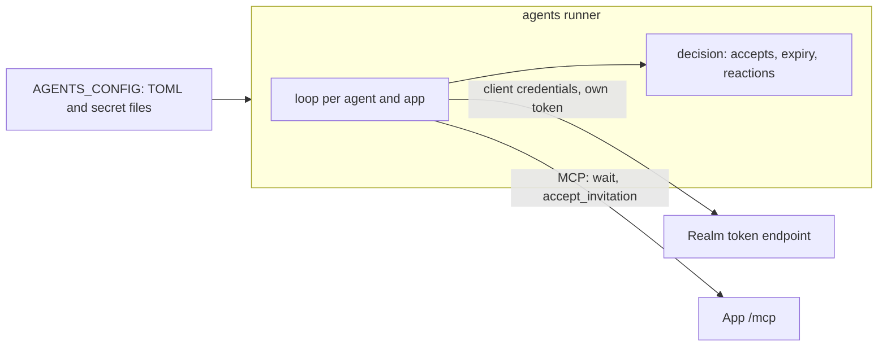

# Agents architecture

## 1. Context and Scope

Agents runs the operator's AI agents as people in his apps; its purpose is in [the vision](VISION.md). What exists is the runner: it signs each agent in to the realm as itself and keeps it waiting in the apps it may join. The persona and memory shape is not ruled yet, so no component for them is described here.

Agents owns the agents' credentials and the runner. The realm owns who an agent is and which apps it reaches, as group membership. An app owns participation and serves the `wait` and accept tools on its `/mcp`; no app imports, calls or configures agents.

## 2. Building Block View

- **The runner** (`src/agents`, console script `agents`) reads and validates the configuration at start, then runs one loop for every agent and every app.
- **A loop** takes a token by client credentials with the app's scope and renews it before it expires. It keeps one `wait` in flight, carrying the last cursor, and accepts each invitation it has not seen refused as stale. A refusal by the realm or the app (a 4xx, a 401 after one renewal, a `wait` tool error, a protocol error, a redirect or a `wait` answer that is no standing) suspends that loop, which retries at a bounded interval and resumes when `wait` answers; a network failure or a 5xx backs off with a capped interval.
- **Decisions** (`decision.py`) are pure: standings in, accepts out; token expiry against a given clock; the reaction to a status.
- **Boundaries** are the token endpoint, the MCP session (the official SDK over the JSON-only streamable HTTP of agent-runtime), the clock and the log, each behind a narrow port so the loop is judged with scripted ones.
- **The log** holds each state change once (started, suspended, resumed, joined, refused) with the client id, the app and a status or refusal code, and no secret, token or tool content.

## 3. Checks

Every pull request runs `Lint and test` (ruff, pyright strict, vulture, pytest with branch coverage), `Documents` (lychee, offline, over the tracked Markdown) and the shared quality gate of overnightworks/quality (its check and Sonar jobs), which judges both through `quality/config.toml`; `quality / verdict` is the check a merge requires. CodeQL analyses the workflows and the Python, and Dependabot proposes updates to the pinned actions and the locked dependencies.
